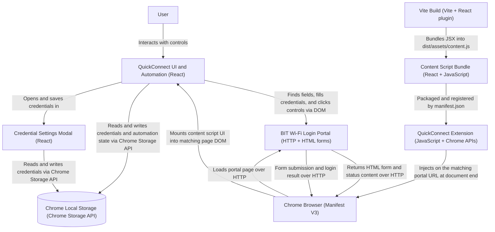

# QuickConnect

QuickConnect is a Chrome extension built with React and Vite that helps automate the Wi-Fi login flow for the BIT portal. It detects the login page, fills in saved credentials, and can automatically submit the form for you.

## System Architecture

The extension runs its React interface and automation in the matched portal page. Credential and automation state are stored locally by Chrome; the project has no separate application server or remote database.

This project is not meant to hack or misuse any college system. It is simply an automation helper for the official Wi-Fi user login page and is intended for convenience and personal use.

## Features

- Saves your BIT username and Wi-Fi password locally in Chrome storage
- Automatically detects common login and success/error states
- Lets you connect or stop automation with a single click
- Provides a clean settings modal for updating credentials
- Built as a Chrome Manifest V3 extension

## Tech Stack

- React
- Vite
- JavaScript
- Chrome Extension Manifest V3

## Project Structure

- src/App.jsx - main popup UI and automation logic
- src/settingsModel.jsx - modal for storing credentials
- src/content/index.jsx - content script injected into the target portal page
- manifest.json - extension configuration

## Usage

1. Open the Wi-Fi login portal page that matches the extension target.
2. Click the extension icon.
3. Open Settings and save your BIT username and password.
4. Click Connect to start automation.
5. Use Stop Automation at any time to halt the process.

## Notes

This extension is currently configured to inject its content script on the portal URL:

- http://172.16.0.200:2280/*

## Author

Crafted by Bhadri Prabhu K